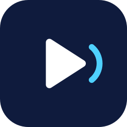

<div align="center">



# CLPlayer

**Android music player built on YouTube Music, with playlist import from Spotify and Apple Music, synced lyrics and Last.fm scrobbling.**

</div>

CLPlayer is an independent fork of [LastWave-Native](https://github.com/Clash-Projects/LastWave-Native) by Clash Projects and contributors,
distributed under the same license (GPL-3.0, see [LICENSE](LICENSE)). It is **not affiliated with or endorsed by** the original project,
Google, YouTube, Spotify, Apple or Last.fm.

## What is different from the original

- Different application id (`com.clplayer.app`), name and logo, so it installs next to the original app.
- The live listening telemetry (reporting the playing track to a third-party map) has been removed.
- The Spotify import warns when a public playlist is larger than the ~100 tracks Spotify's public page exposes, and the embed parser keeps the playlist order.
- Links to the original project's community channels and update feed were removed or pointed at this repository.

## Build

Requires JDK 17 and the Android SDK.

```bash
./gradlew assembleDebug
```

The debug APK is written to `app/build/outputs/apk/debug/`.

## Notes

- Audio is streamed from YouTube Music, which may conflict with YouTube's terms of service. Use at your own risk.
- The Jam (shared listening) feature still talks to a server operated by the original project.
